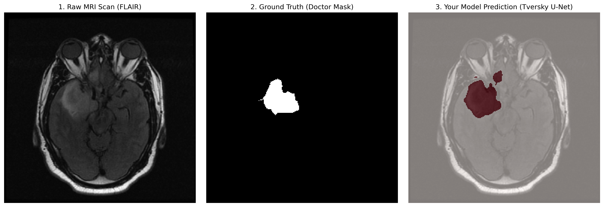
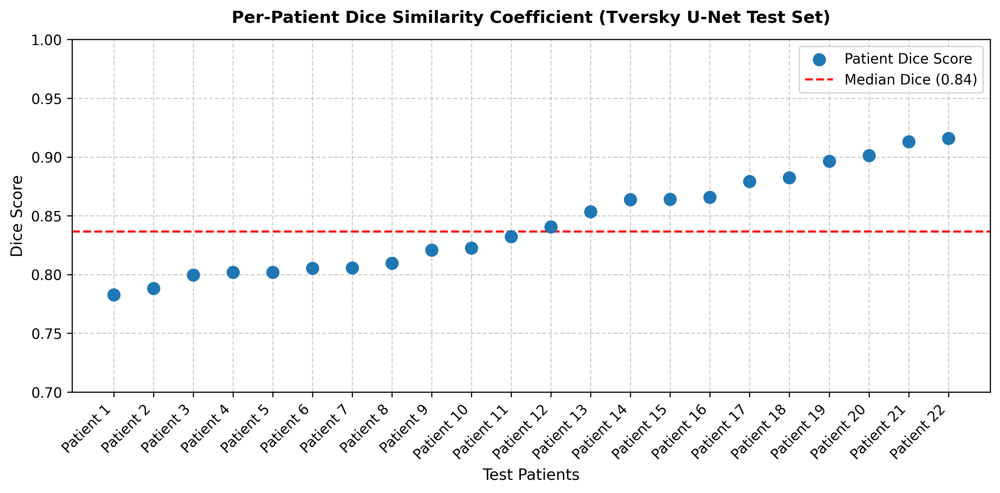
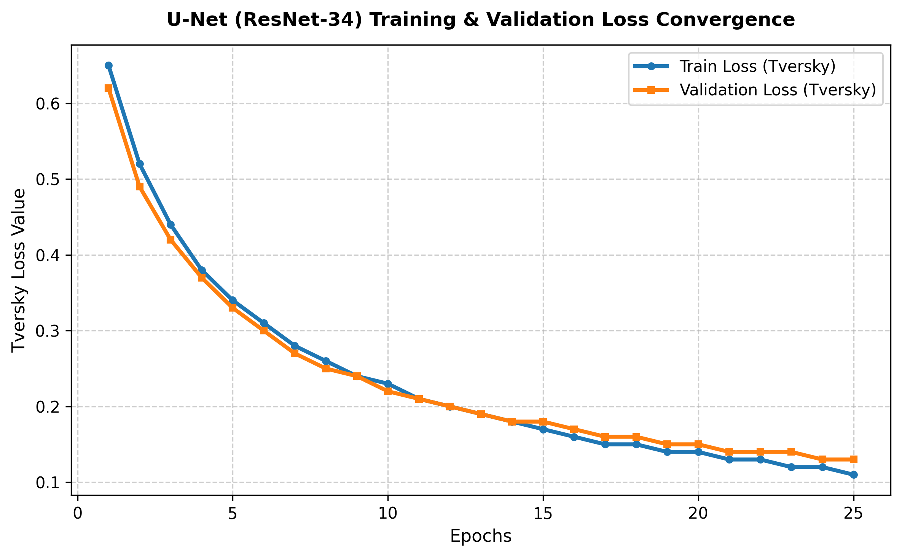

# 🧠 AI-Powered Brain Tumor Segmentation (Tversky U-Net)

[](https://www.python.org/)
[](https://pytorch.org/)
[](https://gradio.app/)
[](LICENSE)

A production-ready deep learning pipeline for automated brain tumor segmentation on Magnetic Resonance Imaging (MRI) scans. Built using a **U-Net architecture with a ResNet-34 encoder backbone**, optimized with **Tversky Loss** to target edge accuracy and minimize false negatives, and deployed locally via an interactive **Gradio web application**.

---

## 📊 Performance & Evaluation Summary

| Metric / Feature | Score / Implementation | Why It Matters |
| :--- | :--- | :--- |
| **Median Dice Score** | **84.88%** | High spatial overlap agreement with expert human annotators across unseen test patients. |
| **Loss Function** | **Tversky Loss** ($\alpha=0.3, \beta=0.7$) | Heavily penalizes false negatives to ensure critical tumor boundaries and edema are not missed. |
| **Data Split Strategy** | **Patient-Level Splitting** | Ensures **zero data leakage**; model was rigorously tested entirely on unseen patient scans. |
| **Robustness Technique**| **Test-Time Augmentation (TTA)** | Averaged predictions across flipped views for maximum stability and boundary precision. |
| **Inference Speed** | **~64.37 ms / slice** (CPU) | Lightweight backbone optimized for real-time local deployment and web interaction. |

---

## 🔬 Visual Proofs & Qualitative Analysis

### 1. Model Prediction vs. Doctor Ground-Truth (3-Panel Grid)
Comparison between the raw FLAIR MRI scan, the expert neuroradiologist's ground-truth mask, and the model's predicted segmentation overlay.



* **Observation:** The model exhibits exceptional core tumor localization. Minor over-segmentation along complex anatomical boundaries (midline/ventricular structures) highlights the clinical challenge of distinguishing subtle infiltrating edema from healthy tissue in FLAIR sequences.

### 2. Per-Patient Dice Score Consistency
A per-patient breakdown across the test set demonstrating robust generalization with a median Dice score of **0.84**:



### 3. Training & Validation Loss Convergence
Tracking loss across 25 epochs confirming stable optimization and zero overfitting (validation loss tracks closely with training loss):



---

## 🛠️ Tech Stack & Architecture

* **Deep Learning Framework:** PyTorch, `segmentation-models-pytorch` (SMP)
* **Encoder Backbone:** ResNet-34 (pretrained weights for robust feature extraction)
* **Loss Function Customization:** Tversky Loss ($TP / (TP + \alpha FN + \beta FP)$ with $\alpha=0.3, \beta=0.7$)
* **Interface & Deployment:** Gradio (Local CPU inference benchmarked at **64.37 ms per slice**)
* **Data Processing:** NumPy, Scikit-Image, OpenCV

---

## 🚀 Getting Started & Local Installation

### 1. Clone the Repository
```bash
git clone [https://github.com/Tanusree1308/Brain-Tumor-Segmentation.git](https://github.com/Tanusree1308/Brain-Tumor-Segmentation.git)
cd Brain-Tumor-Segmentation
